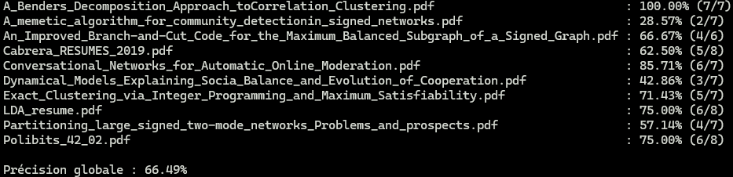

# TP Conception logicielle - Scrum

**Auteurs : L3 CMI Informatique**

- Angelo Adragna
- Corentin Saccoman
- Elliot Pozucek
- Colin Palazzetti Rubera
- Elvin FICHOT--CORGERON

<!--jupyter nbconvert --to pdf integrale.ipynb-->

## **Roles**

- Angelo est le maitre de `SCRUM`.
- Corentin, Elliot, Colin et Elvin sont `développeurs`.

## Contexte et Objectif

Dans le cadre de notre projet de parseur de fichiers scientifiques, le Département de contrôle qualité du LIA nous a demandé d'évaluer la **précision** du système de détection automatique de sections. Pour cela, une comparaison a été réalisée entre les résultats du parseur et un *corpus de référence* constitué manuellement.

La précision est définie par la formule :

Précision = Sections correctes trouvées par le système / Sections trouvées par le système

Deux types de frontières sont considérées : strictes (toutes les phrases correctement incluses) et souples (± 2 phrases tolérées).

---

## Méthodologie

### 1. Répartition des rôles

- **Angelo Adragna** : SCRUM Master, Product Owner, rédaction du rapport et coordination.
- **Corentin Saccoman & Elliot Pozucek** : calculs de précision avec frontières strictes.
- **Colin Palazzetti Rubera & Elvin Fichot-Corgeron** : annotation manuelle du corpus de référence avec les frontières souples.

### 2. Création du corpus de test

Dix articles scientifiques ont été sélectionnés. Pour chaque article, nous avons :

- Extrait les sections avec le parseur (mode XML).
- Annoté manuellement les véritables frontières dans un fichier `frontieres.xml`.
- Compté le nombre de sections détectées, correctes, et réellement présentes.
- Utilisé le script `precision.py` pour calculer les scores de précision.

*Une option `--no-verbose` a été ajoutée pour faciliter les tests.*

---

## Résultats

- **Nombre d’articles testés** : 10  
- **Précision moyenne observée** : **66.49%**  
- **Fichiers avec formats complexes** : baisse significative de la précision (jusqu’à 0%)

Les performances varient fortement selon la qualité du PDF (présence de colonnes, tableaux, etc.). Un cas extrême (article 2) a fortement impacté la moyenne globale.

---

## Analyse et pistes d’amélioration

- **Robustesse** : Le parseur souffre de problèmes liés à la diversité des structures PDF. Des traitements adaptatifs sont nécessaires (ex : détection automatique de colonnes).
- **Débogage facilité** : L'ajout du mode `--no-verbose` et du fichier `precision.py` ont facilité les tests.

---

## Conclusion

Ce sprint a permis d'établir une première évaluation quantitative du système. Malgré des résultats encore perfectibles, la précision moyenne de **67%** montre un comportement correct sur la majorité des cas. L'analyse fine des échecs oriente les améliorations à venir sur la robustesse du pré-traitement et la gestion des formats complexes.

Un sprint supplémentaire aurait logiquement permis une nette amélioration des performances, en intégrant ce corpus de test dans une phase d'apprentissage supervisé, afin d'ajuster dynamiquement les heuristiques de détection aux cas récurrents d'erreur observés.

---

**Lien GitHub :** [github.com/conception-logicielle-CERI/parseur-pdf](https://github.com/conception-logicielle-CERI/parseur-pdf)

