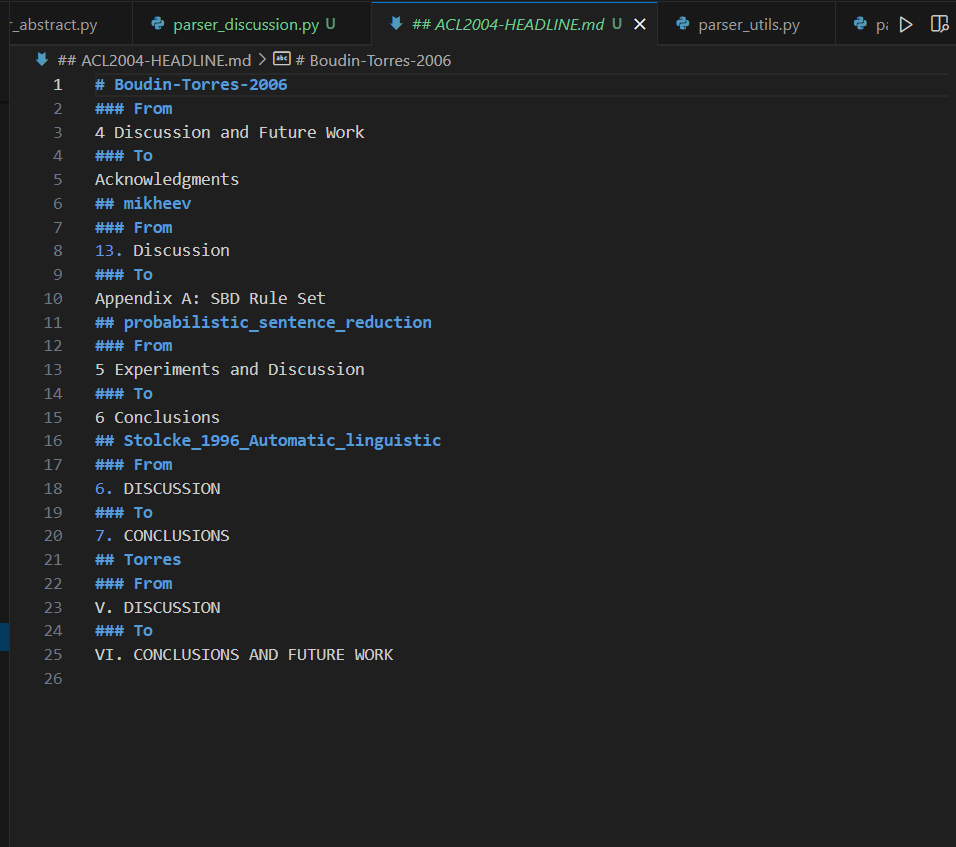
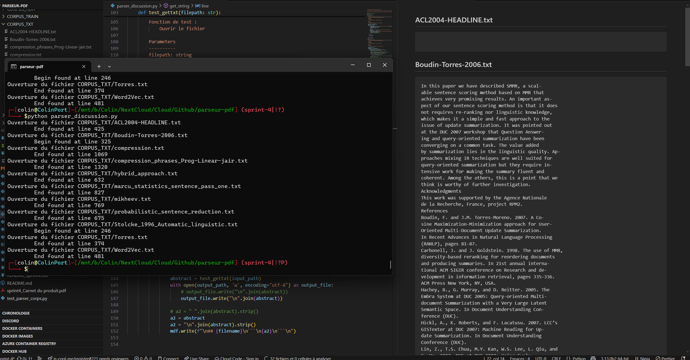
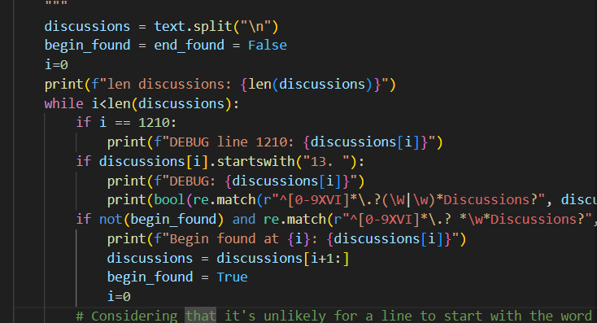
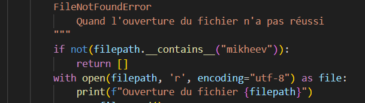

## 4. **Colin Palazzetti Rubera** : Récupération de la section `discussion` (`evaluation`) et s'occupe de la redondance de certains codes.

### Partie récupération
La partie discussion/évaluation n'est présente que dans très peu d'articles :

La présence d'une fonction de test locale permet de bien identifier (et notamment via la génération d'un markdown qui résume les trouvailles) les points à améliorer :

Néanmoins, la présence de possible détection de fin avant le début, il a fallu débug pour comprendre ça :

Cela a permis de détecter ce problème et de le corriger en requérant le début pour chercher la fin

Et vu que pour mes tests j'ai limité à un seul fichier, ça ne marchait évidemment pas pour les autres (5 minutes de perdues) :

### Analyse du code
- Optimisation des regex
- vérification de l'optimisation des if
- vérification de l'optimisation des affectations de variables

### Pistes d'amélioration

### Analyse de performances
Les performances moins bonnes de python sont compensées par 

### **Remarque**

### Dates clés :
12/05 : découverte du travail et premières reflexion

13/05 : relecture du code et ajout des optimisations

14/05 : relecture du code et ajout des optimisations, rédaction du README
