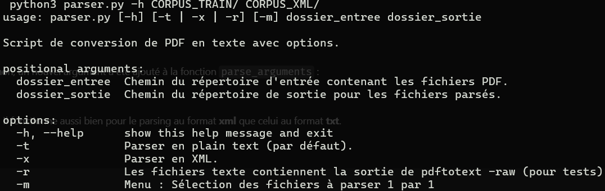
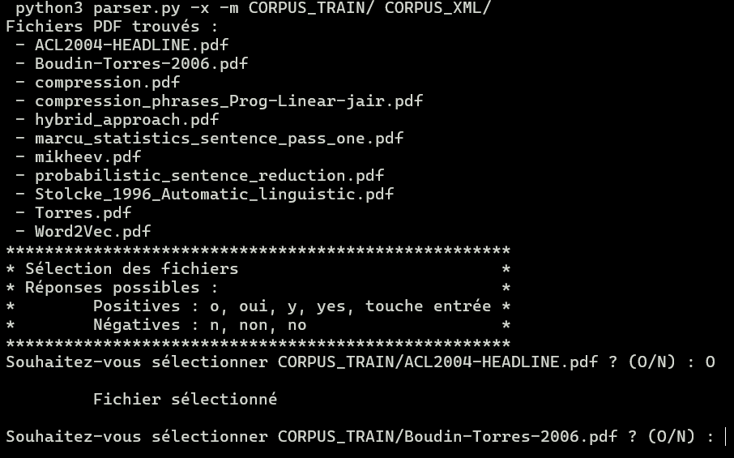
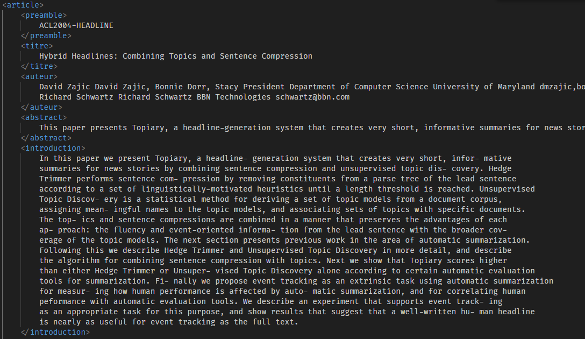

## 2. **Corentin Saccoman** : Récupération de la section `introduction` et réaliser le menu de sélection de fichiers.

### **2.1. Ajout du menu de sélection de fichiers**
   
#### **Analyse du code**
Afin de créer un menu permettant de choisir quel fichier parser ou non, un nouvel argument a été ajouté à la fonction `parse_arguments` :  
- **-m** (Pour menu). 
 
Ce nouvel argument est indépendant des autres et donc cumulable. Il fonctionne aussi bien pour le parsing au format **xml** que celui au format **txt**.  

Pour chaque fichier du répertoire d'entrée, le programme demande à l'utilisateur s'il désire le sélectionner ou non. Les réponses possibles sont les suivantes :  
- **Positives :**  
  - o, oui, y, yes, *touche entrée*
- **Négatives :**
  - n, non, no  
  
**REMARQUE :** La réponse n'est pas sensible à la casse.

C'est la fonction `list_pdfs` qui a été adaptée pour intégrer cette possibilité de choisir, en lui passant les options en paramètres.


#### **Exemples d'utilisation (complément du sprint 3):**
```sh
# Affichage de l'aide pour les options : 
python parser.py -h

# Pas d'option de sélection des fichiers à parser :
python parser.py CORPUS_TRAIN/ CORPUS_TXT/          # Format txt sans option
python parser.py -t CORPUS_TRAIN/ CORPUS_TXT/       # Format txt avec option
python parser.py -x CORPUS_TRAIN/ CORPUS_XML/       # Format xml 

# Sélection manuelle des fichiers à parser :
python parser.py -m CORPUS_TRAIN/ CORPUS_TXT/       # Format txt sans option
python parser.py -t -m CORPUS_TRAIN/ CORPUS_TXT/    # Format txt avec option
python parser.py -x -m CORPUS_TRAIN/ CORPUS_XML/    # Format xml
```
**Résultats attendus :**   
Le répértoire CORPUS_TXT/ contiendra les fichiers texte avec uniquement le nom du fichier, le titre et l'abstract  
Le répértoire CORPUS_XML/ contiendra les fichiers xml avec toutes les infos demandées pour le xml  

#### **Visualisation de l'exécution**
**Menu d'aide pour les options**  


**Choix des fichiers**  


#### **Pistes d'amélioration**
- Créer une fenêtre style TKinter afin d'avoir une représentation graphique et cliquable pour choisir les fichiers et le format de sortie (mais cela n'est pas demandé par le client).

#### **Analyse de performances**
L'ajout de cette option n'allourdit pas la consommation de ressources du parsing car elle n'intervient pas sur le processus d'analyse et de transformation du texte.

### **2.2. Récupération de la section `introduction`**
#### **Analyse du code**
Afin de réaliser le parsing de la section `Introduction` des fichiers pdf, j'ai créé le fichier `parser_intro.py` contenant la fonction suivante :  
```python
def extract_introduction(content: str) -> str:
    """
    Extrait la section 'Introduction' seule, jusqu'au début de la section suivante.
    Le texte est reformatté avec des retours à la ligne tous les ~100 caractères.
    """
```  
Comme indiqué dans la docstring, cette fonction récupère la section qui nous intéresse en se basant sur des expressions régulières. En effet, tous les fichiers (sauf une exception qui confirme la règle) contiennent une numérotation de leurs sections :  
- `1 `..., `2 `..., `3 `...
- `1. `..., `2. `..., `3. `...
- `I. `..., `II. `..., `III. `...

En conséquence, la récupération se déroule de la manière suivante :
- Découpage du texte ligne par ligne.
- Le programme détermine à partir de quelle ligne commence l'introduction grâce à une expression régulière.
- Le programme cherche l'expression exacte `A noisy-channel model for sentence compression` pour que l'exécution fonctionne aussi sur le fichier *marcu_statistics_sentence_pass_one.pdf* qui ne contient pas de numérotation. Dans ce cas, il détermine la ligne où se trouve cette expression pour pouvoir découper la partie qui nous intéresse et enlever le reste.
- S'il n'a pas trouvé l'expression exacte précédente, il cherche un pattern commançant par le chiffre deux (2, 2. ou II.) afin d'isoler la partie suivante, à laquelle la récupération s'arrêtera.  


La fonction `extract_introduction` est appelée dans le programme `parser.py` en même temps que celles correspondant aux autres balises afin d'intégrer l'introduction au xml.



#### **Pistes d'amélioration**
- Essayer de trouver un moyen de ne plus avoir recours à une expression régulière spécifique à un fichier. En clair, trouver un moyen de parser l'introduction quand les sections ne sont pas numérotées (très complexe en l'état).

#### **Analyse de performances**
Le processus de parsing prend tout de suite plus de temps, étant donné qu'on rajoute du traitement. Mais cela reste largement acceptable et ne ralentit pas drastiquement le programme.

#### **Remarques**
Durant l'analyse, les traits d'union permettant d'unifier des mots séparés entre deux lignes sont bien gérés afin de les réunifier. Cela n'a pas d'incidence sur les mots composés classiques.

### **Dates clés :**
- 12/05/2025 : Fin du développement et de l'intégration du menu de choix des fichiers.
- 12/05/2025 : Fin de la récupération de la section d'introduction.