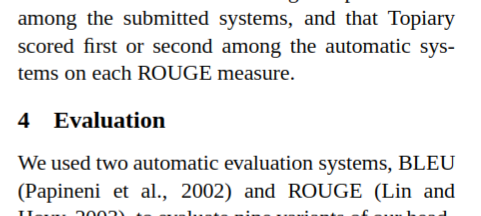
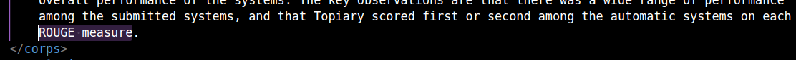

## **Elliot Pozucek** : Récupération du corps de chaque fichier.

### Analyse du code

#### Général

Afin de détecter correctement les parties à inclure dans le corps, j'ai analysé pour chaque fichier les *headers* de chaque section. J'ai ensuite compilé les sections qui m'intéressaient pour le corps. Voici l'analyse :
| Nom du fichier                          | Section Intro       | Section Début Corps                          | Section Fin Corps               |
|-----------------------------------------|---------------------|----------------------------------------------|----------------------------------|
| ACL2004-HEADLINE.txt                    | 1 Introduction      | 2 Previous Work                              | 6 Conclusions and Future Work   |
| Boudin-Torres-2006.txt                  | 1 Introduction      | 2 Method                                     | 4 Discussion and Future Work    |
| compression_phrases_Prog-Linear-jair.txt| 1. Introduction     | 2. Related Work                              | 6. Conclusions                  |
| compression.txt                         | 1 Introduction      | 2 Related Work                               | 7 Future Work                   |
| hybrid_approach.txt                     | 1 Introduction      | 2 From Full Sentence to Compressed          | 4 Conclusion                    |
| marcu_statistics_sentence_pass_one.txt  | Introduction        | A noisy-channel model for sentence          | Evaluation                      |
| mikheev.txt                             | 1. Introduction     | 2. Performance Measure, Corpora for Evaluation, and Intended Markup | 13. Discussion                  |
| probabilistic_sentence_reduction.txt    | 1 Introduction      | 2 Support Vector Machine                    | 5 Experiments and Discussion    |
| Stolcke_1996_Automatic_linguistic.txt   | 1. INTRODUCTION     | 2. THE IMPORTANCE OF LINGUISTIC SEGMENTATION| 6. DISCUSSION                   |
| Torres.txt                              | I. INTRODUCTION     | II. RELATED WORK                             | VI. CONCLUSIONS AND FUTURE WORK |
| Word2Vec.txt                            | 1 Introduction      | 2 Model Architectures                        | 6 Conclusion                    |

Avec cette analyse, j'ai pu identifier les paternes Regex que je peux implémenter afin de recupérer le corps de chaque fichier.

Une fois le corps récupéré, il est formatté pour être bien et beau dans le xml (ajout de tabulation tous les ~100 caractères).

Afin d'illustrer le bon fonctionnement du programme, voici quelques images :

Dans le pdf, on voit que la section de conclusion commence juste après "on each ROUGE measure.".



Dans le xml, on retrouve bien cette phrase à la fin du corps :



#### Paternes de début

J'ai d'abord essayé de trouver une méthode robuste pour identifier le header de la section directement après l'introduction (ex: II. RELATED WORK), mais sans succès. J'ai donc décidé de me concentrer sur les paternes de fin.
Pour les paternes de début de corps, j'ai tout simplement inclus l'introdcution dans le corpus. Voici le paterne de début de corpus :

```python
intro_match = re.search(r"\bIntroduction\b.*?", cleaned, re.IGNORECASE)
```

#### Paternes de fin

Voici les paternes que j'ai codés pour détecter les dernières sections du corps d'un article.  
Ces sections délimitent la fin du corps que l'on souhaite extraire, et sont basées sur la présence explicite de mots-clés caractéristiques d'une conclusion.

Les mots-clés pris en compte sont les suivants (insensibles à la casse) :

- **Conclusion**
- **Conclusions**
- **Discussion**
- **Future Work**
- **Evaluation**
- **CONCLUSION**
- **CONCLUSIONS**
- **DISCUSSION**
- **FUTURE WORK**
- **EVALUATION**

##### Paternes utilisés :

```python
r"^\s*\d{1,2}\.?\s+(Conclusion|Discussion|Future Work|Evaluation|Conclusions|CONCLUSIONS|DISCUSSION|FUTURE WORK|EVALUATION)\b"
```

Ce paterne détecte les titres de section numérotés, comme :

- `6 Conclusion`
- `12. Evaluation`
- `5 Future Work`
- `6. DISCUSSION`

Je considère les majuscules et minuscules (sans utiliser *ignorecas*) car cela simplie grandement la détection des *headers* de section.

```python
r"^\s*[IVX]+\.\s+(CONCLUSIONS?|DISCUSSION|FUTURE WORK|EVALUATION)\b"
```

Ce paterne permet de détecter les titres de section avec une numérotation romaine, en majuscule :

- `VI. CONCLUSIONS`
- `IV. DISCUSSION`

En pratique, un seul des fichiers du corpus suit ce paterne.

```python
r"^\s*(Conclusion|Discussion|Future Work|Evaluation)\s*$
```

Ce dernier paterne couvre les cas où la section est indiquée sans numérotation :

- `Conclusion`
- `Evaluation`

Il s'applique uniquement si ces mots apparaissent seuls sur leur ligne (la casse doit être strictement respectée).

### Pistes d'amélioration

Il a été décidé lors du *product backlog* que l'introduction en faisait pas partie du corps, donc ma solution ne respecte pas vraiment les consignes. Ainsi, il faudrait que je récupère la méthode de détection des deuxièmes sections auprès de Corentin afin de bien respecter les consignes.

---

### Analyse de performances

Mon programme n'a pas augmenté le temps d'éxécution sur ma machine (toujours autour de 1 seconde). À voir avec les autres parties du sprint-4.

---

### **Remarque**

La version actuelle est 100% fonctionnelle pour tous les fichiers du corpus, si on considère l'introduction comme faisant partie du corps.

---

### Dates clés :

### 12/05 :
 - Création de `parser_corps.py`
   - récupération du corps de chaque fichier, de l'introduciton (incluse) à la dernière section (soit la *conclusion*, soit *discussion*, soit *futur work*)