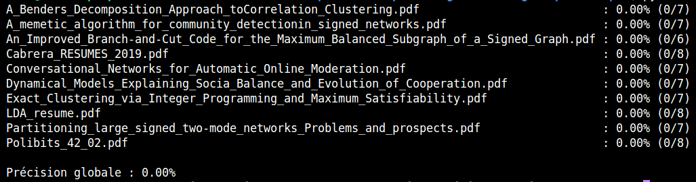

## 3. **Elliot Pozucek**, **Corentin Saccoman** : Test précision avec des frontières strictes (en binôme)

### **Développement**

---

#### Comptage des frontières

Afin d'évaluer la précision de notre algorithme sur l'ensemble de test, nous avons besoin de connaître le nombre de frontières présentes dans chaque article, le nombre de frontières trouvées par notre algorithme et le nombre de frontières trouvées par notre algorithme qui sont correctes (bien délimitées à +/- 2 lignes près).

Pour être précis :

 - nous avons créé un fichier `frontieres.xml`
 - ce fichier contient les mêmes balises que les fichiers xml résultants de l'algorithme (\<titre>, \<auteur>, etc)
 - trois balises ont été ajoutées :
    - \<frontieres-veritables> : le nombre de frontières réellement présentes dans l'article
    - \<frontieres-trouvees> : le nombre de frontières trouvées par l'algorithme
    - \<frontieres-correctes> : le nombre de frontières trouvées par l'algorithme qui sont correctes (bien délimitées à +/- 2 lignes près)
 - Une balise <document> a été ajoutée pour chaque article, avec un nom (ex: \<document nom="article1">)

##### Comtage des frontières réelles

Voici la méthode utilisée pour compter le nombre de frontières présentes dans un article :
 - on éxécute l'algorithme avec l'option -r (python parser.py -r CORPUS_TEST/ CORPUS_TEST_RAW/)
 - pour chaque article :
    - on ouvre le pdf et le fichier txt (raw)
    - pour chaque section :
        - on repère dans le pdf le début de la section
        - on cherche la première ligne de la section dans le txt (raw)
        - on écrit le numéro de la ligne dans le fichier `frontieres.xml`
        - on cherche la fin de la section dans le pdf
        - on cherche la première ligne de la section dans le txt (raw)
        - on écrit le numéro de la ligne dans le fichier `frontieres.xml`
        - cela donne par exemple : \<titre>1-3\</titre> (le titre se situe entre la ligne 1 et la ligne 3 dans le txt raw)
        - si la section n'existe pas dans le pdf, on écrit `None`
    - une fois ce travail effectué pour chaque section, on compte le nombre de sections réellement présentes dans l'article en comptant le nombre de balises où il n'y a pas de `None` et on écrit le résultat dans le fichier `frontieres.xml`, dans la balise \<frontieres-veritables>
 - une fois ce travail effectué pour chaque article, le fichier `frontieres.xml` contient le nombre de sections présentes dans chaque article

##### Comptage des frontières trouvées

Voici la méthode utilisée pour compter le nombre de frontières trouvées par notre algorithme :
 - on éxécute l'algorithme avec l'option -x (python parser.py -x CORPUS_TEST/ CORPUS_TEST_XML/)
 - pour chaque article :
    - on ouvre le fichier xml
    - on compte le nombre de balises non-vides (la balise \<preambule> est ignorée), le nombre de balises non-vides correspond au nombre de sections trouvées par l'algorithme
    - on écrit le résultat dans le fichier `frontieres.xml`, dans la balise \<frontieres-trouvees>
 - une fois ce travail effectué pour chaque article, le fichier `frontieres.xml` contient le nombre de sections trouvées par l'algorithme dans chaque article

---

#### Ajout de l'option --no-verbose (Elliot)

Lors de la réalisation de ma partie du sprint-5, j'ai remarqué que le terminal était très pollué par les messages de parsing. Bien que ces messages soient utiles, j'ai décidé de créer une option `--no-verbose` pour permette de les désactiver.

J'ai donc ajouté la ligne suivante dans `parser.py`, dans la fonction `parse_arguments()` : 
```python
# Ajout d'un argument --no-verbose pour désactiver les messages d'information
parser.add_argument("--no-verbose", action="store_true", help="N'affiche pas les informations détaillées pendant l'exécution.")
```

J'ai ensuite ajouté une vérification dans les méthodes `convert_pdf_file()` et lors de l'énumération des fichiers pdf dans le `main` afin de ne pas afficher les messages si l'option `--no-verbose` est activée.

```python
# convert_pdf_file
if not args.no_verbose :
    print(f"{fichier_pdf.name} converti en {fichier_sortie.name}")

# main
if not args.no_verbose:
    print("Fichiers PDF trouvés :")
    for pdf in pdfs:
        print(" -", pdf.name)
```

Cette option est robuste et fonctionne avec toutes les autres options (j'ai testé avec toutes les combinaisons d'options possibles).  
Par exemple, on peut exécuter la commande suivante :
```bash
python parser.py -x --no-verbose CORPUS_TEST/ CORPUS_TEST_XML/
```
Cela va exécuter l'algorithme avec l'option -x (génération du fichier xml) et l'option `--no-verbose` (pas de messages d'information).

---

#### Ajout du fichier precision.py (Elliot)

Une fois que le fichier `frontieres.xml` a été correctement rempli, j'ai voulu créer un script permettant de calculer la précision de notre algorithme en fonction de ce fichier.  
J'ai donc créé le fichier `precision.py` qui contient la fonction `calcul_precision()`. Cette fonction prend en entrée un chemin (str) et écrit dans le terminal la précision de l'algorithme sur chaque article de l'ensemble de test, ainsi que la précision globale sur cet ensemble. Ce script ne fonctionne qu'avec le fichier `frontieres.xml` ou avec un fichier xml de même structure.

La précision pour chaque article est calculée conformément à la formule donnée dans l'Objectif du sprint-5 :

```python
precision = frontieres_correctes / frontieres_trouvees
```

Le script va parser le fichier xml donné en entrée (`frontieres.xml`) et va, pour chaque article, récupérer le nombre de frontières trouvées et le nombre de frontières correctes. La précision est calculée puis affichée dans le terminal. Les erreurs sont gérées (ex: si le nombre de frontières trouvées est égal à 0, pas un nombre, si les balises ne sont pas présentes, etc).

Voici un exemple d'utilisation (précision = 0 car pas encore de comptage des frontières correctes) :




#### Comptage manuel du score de chaque fichier (Corentin)
Une fois le nombre de frontières déterminées, il a fallu vérifier manuellement leur correspondance avec la réalité.  
J'ai alors rempli la balise \<frontieres-correctes> afin d'apporter une consolidation aux résultats trouvés pas Colin et Elvin.  

J'ai effectué cette mesure manuelle sur l'intégralité des fichiers de test.  
Pour ce qui est des résultats trouvés par Elvin, ils concordaient.  

Suite à ces mesures et au remplissage des balises du fichiers `frontieres.xml`, j'ai pu exécuter le programme `precision.py` afin de calculer la précision individuelle de chaque fichier ainsi que la précision globale du parseur.  
  

Le score global est fortement affecté par le deuxième fichier, ayant un formatage assez singulier, dégradant les performances du parseur.

### **Remarque**

### **Précision**
On apperçoit que notre programme obtient un score de précision de 66.49% sur le jeu de test.
### **Piste d'amélioration**
Le résultat n'est pas surprenant. Le programme est assez précis sur les documents qui respectent rigoureusement la structure établie sur les fichiers d'entrainement. Cependant, dès que cette structure varie, les performances en subissent les conséquences.  
Il n'y a pas vraiment d'amélioration possible à apporter au programme. En effet, nous ne pouvons pas prédire comment un article de recherche va être rédigé, quel nom va avoir chaque partie etc...  
Afin d'éviter de saisir des mots hors de leur contexte (par exemple de prendre un titre au milieu d'une phrase à cause d'une numérotation), nous pourrions apporter une vérification sur le contexte du groupe de mots trouvé, afin d'augmenter la robustesse du programme.  
Néanmoins, des sections comme celles des auteurs ou le titre, n'étant pas identifiées distinctement, demeurent impossibles à relever sans une part de hasard.
### **Dates clés** :
- Corentin, Elliot, 16/05 : Réalisation du fichier `frontieres.xml` et découpage manuel des fichiers de test.
- Elliot, 18/05 : Réalisation du programme de test de précision, ajout d'un argument au parseur, actualisation du balisage de `frontieres.xml`
- Corentin, 18/05 : Détermination des performances du parseur et attente des résulats de Colin pour vérifications.