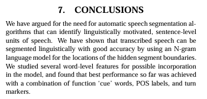
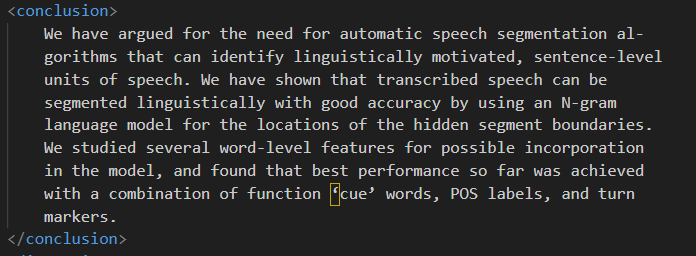

# Sprint 4 Elvin FICHOT--CORGERON

## **Récupération de la conclusion**

Pour ce sprint j'ai eu pour tâche de récupérer la section conclusion dans le texte

### Approche du travail :

Pour rechercher la section je recherche les différents titre possibles (Conclusion, Future Work ...)

Ensuite je récupère tous le texte jusqu'à trouver la prochaine section qui est forcément Acknowledgments ou References.

Ensuite je supprime les lignes non essentielles tel que le numéro de pages le nom de l'auteur ...

### **Dévelepement**

J'ai développé 3 méthodes pour parvenir à l'extraction

`get_string`, `build_section_regex` et `clean_string`

#### `get_string`

Cette méthode est la méthode principale qui va renvoyé la section au parseur. Dans cette méthode je trouve la section de début de la conclusion et la section de fin. Je récupère ensuite le texte qui est entre les 2 je retire les éléments inintérrssant et renvoie le texte

#### `build_section_regex`

Dans cette méthode j'identifie le pattern d'une section avec une regex. Cette méthode a été crée pour éviter de dupliquer du code pour chercher le pattern d'une section, le début et la fin.

#### `clean_string`

Dans cette méthode je retire les lignes inutiles tels que les noms d'auteurs où les numéros de page.

#### Résultats

La conclusion dans les pdf ressemble à ça :

Ensuite après le parsing j'obtient ce résultat :

## **Remarque**

### Erreurs

Dans cette première version la conclusion n'est pas extraite correctement pour un seul fichier. En effet dans un fichier on a le titre qui se trouve au milieu de la version. Et il contient le mot References

`Summary Evaluation with and without References`

Je n'ai pas réussi à faire en sorte que l'exclusion ne soit pas pris en compte pour cette ligne.

### Piste d'amélioration

Je pense que le je pourrais améliorer la robustesse dans la recherche des sections de début et de fin afin d'être plus efficace et de couvrir correctement tous les cas.

### Analyse des performances

Le temps d'éxécution du programme n'a pas changé et reste le même que sans la recherche de la conclusion

## **Dates clés** :

- 12/05 : Lancement du sprint 4

- 13/05 : Première version terminé
