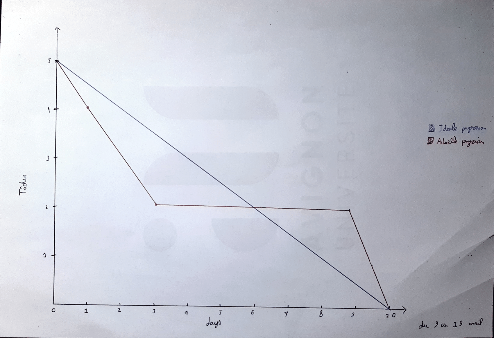
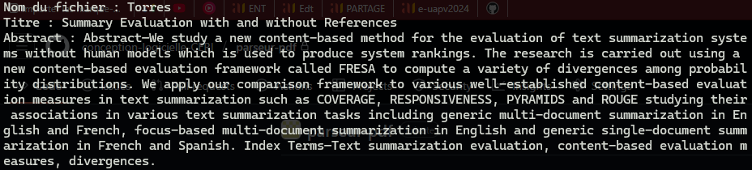
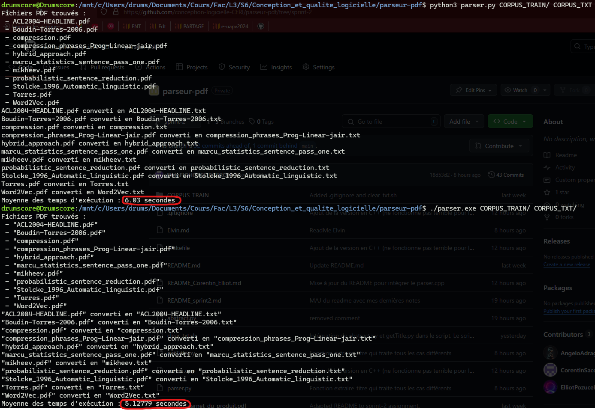
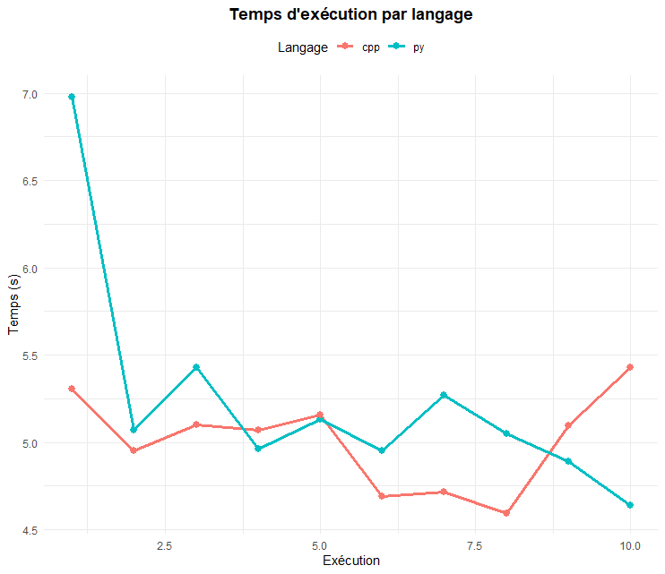

# Sprint 2

**Auteurs : L3 CMI Informatique**

- Angelo Adragna
- Corentin Saccoman
- Elliot Pozucek
- Colin Palazzetti Rubera
- Elvin Fichot-Corgeron

<!--pandoc README_sprint1.md -o README_sprint1.pdf --pdf-engine=xelatex-->

## **Rôles**

- Angelo est le maître de `SCRUM`.
- Corentin doit créer la structure de l'algorithme en prenant en paramètre un dossier pdf, appelant les différentes méthodes et en renvoyant un dossier de txt.
- Elliot doit traiter le nom du fichier d'orgine.
- Colin doit traiter le résumé (abstract) de l’auteur.
- Elvin doit traiter le titre du papier.

## **Objectif**
Dans la séance précédente vous avez choisit le convertisseur le plus adapté PDF→texte. Il s’agit
maintenant d’analyser les articles plain texte par le parseur. Il sera développé dans un langage adéquat,
et analysera les sorties textuelles du convertisseur.
Nous voulons comme sortie un fichier .txt par fichier ayant les sections et la structure suivante.
Les détailles sont dans le [readme](sprint2_carnet_du_produit.pdf).

## **Réunion**
- Debrief sur le produit du premier sprint assez positif, malgré une légère dissipation due à des zones d'ombres sur la consigne.
- Répartition des tâches.
- Liste de questions à donner au Scrum Master pour qu'il échange avec le client sur les besoins.

## **Backlog**
 - Le système doit traiter un dossier contenant des fichiers PDF, créer un sous-dossier pour stocker les sorties en texte brut avec les mêmes noms que les fichiers PDF, et supprimer le       sous-dossier s’il existe déjà.
 - Générer un fichier en texte brut en sortie.
 - Afficher le nom du fichier d’origine sur une ligne, avec les espaces remplacés par des underscores (“_”).
 - Afficher le titre de l’article sur une ligne.
 - Afficher le résumé (abstract) de l’auteur sur une ligne.

Le langage doit être choisi en fonctions des critères :
   1/ Maîtrisé par les membres de l’équipe
   2/ Performance en temps d’exécution

## **Burndown**
  

## **Revu réunion 09/04/25**
 - Répartition des tâches selon les affinités de chacun. Bonne communication et cohésion d'équipe.
 - Discussion et explication des différents artéfacts :
    - Le carnet du produit (Product Backlog) : liste priorisée de toutes les fonctionnalités à développer pour le produit.
    - Le carnet du sprint (Sprint Backlog) : ensemble des tâches sélectionnées pour être réalisées pendant un sprint.
    - L’incrément : version du produit incluant toutes les fonctionnalités terminées à la fin d’un sprint.
    - Les fonctionnalités (User Story) : descriptions simples des besoins utilisateurs, exprimées du point de vue de l’utilisateur.
    - Le diagramme de progression (Sprint Burndown Chart) : graphique montrant l’évolution du travail restant à faire pendant le sprint. 

## **Revu réunion 11/04/25**
 - Soucis pour identifier le debut et la fin des différentes zones de titre et de abstract sachant, que les zones ne sont pas toujours déclarées de façon précises.


## _Consignes pour le compte rendu des développeurs_ : 
- Déposez vos comptes rendu au plus tard le 18/04/2025 à 20h sur la branche 2
- Fournir au moins une image de l'avancement par fonctionnalité.
- Votre compte rendu doit comporter un analyse de votre développe, les aspects positifs, négatifs, limitations...
- Vous devez comparer le temps d'exécution de votre fonctionnalité en python et en C++.
- Indiquer quel jour vous avez fini votre fonctionnalité.

## **Travail de chaque codeur pendant la mêlée (Revue Sprint)**

---

1. **Angelo Adragna** : documenter les événements/artefacts Scrum (réunions de planification de sprint, mêlée quotidienne, revue de sprint, rétrospective du sprint) :
   - Les backlogs doivent être réalisés en premier lieu, lors de la première réunion, afin de répartir les tâches entre chaque personne.
   - Chaque réunion a bien permis d'éclaircir les zones d'ombre sur le projet et le travail de chacun. Cela a également permis d'établir une liste de questions pour le client, afin d'obtenir davantage de détails et de spécifications.
   - Le Burndown est facile à réaliser à la toute fin du sprint.
   - La rédaction doit cependant se faire au fur et à mesure de l'avancement de chacun.
   - La mise en commun du travail de chacun peut parfois s'avérer ardue, en raison du manque de détails dans le fonctionnement des productions personnelles des développeurs.
   - Attention à ne pas mettre une deadline trop proche de la fin du sprint, même si l'idée était de laisser un maximum de temps aux développeurs. Cela les a poussés à rush à la fin, car certaines tâches dépendaient de la finalisation d'autres tâches.


---

2. **Corentin Saccoman** et **Elliot Pozucek** : Structure de l'algorithme de prenant en paramètre un dossier de pdf et appelant les différentes fonctions des autres menbres de l'équipe, traitement du nom du fichier d'orgine.

Réalisation du "squelette" du script python.  
Utilisation des librairies suivantes :
- **subprocess** pour le lancement des commandes bash
- **sys** pour le traitement des paramètres du programme
- **shutil** pour la gestion des répertoires
- **pathlib** pour la gestion des fichiers
- **re** pour l'analyse lexicale avec les expressions régulières

Le programme prend en paramètres le répertoire d'entrée (les fichiers pdf) et un répertoire de sortie (différent du précédent).  
A partir de ces répertoires, les fichiers .pdf sont transformés en .txt dans le répertoire d'accueil avec la commande `pdftotext -raw`.  
Le répertoire de sortie est écrasé s'il existe déjà.

Puis, le script applique les méthodes **get_file_name**, **get_title** et **get_abstract** sur chaque fichier .txt.
Le fichier .txt récupéré avec **pdftotxt -raw** est écrasé avec les infos récupérées par les méthodes susmentionnées (le titre, le nom du fichier et l'abstract).

Exemple de lancement du script :
```bash
python3 script.py CORPUS_TRAIN/ CORPUS_TXT/
```

Le répertoire de sortie (dans cet exemple `CORPUS_TXT/`) contiendra les fichiers .txt avec le nom du fichier, le titre et l'abstract.

### Historique du sprint 2

#### 09/04/2025

Le script est capable de récupérer le nom du fichier. Le script converti les fichiers `.pdf` en `.txt` et les met dans le répertoire de sortie.

#### 11/04/2025

Attente du travail du reste de l'équipe afin de réaliser l'intégration de leurs différentes parties.
Le script gère les erreurs de type "fichier introuvable" et "répertoire introuvable".

#### 18/04/2025

### Intégration du travail de l'équipe

Le script intègre maintenant les fichiers pyhton en charge de récupérer le titre et l'abstract des articles.
Les fonctionnalités principales sont donc terminées.  

Un exemple de fichier .txt en sortie :
  

**Remarque** : Chaque section est écrite sur une seule ligne à la fois, comme demandé dans le sujet (sur la capture d'écran, les retours à la ligne sont causés par l'affichage dans la console).

### Ajout d'une mesure de temps d'éxécution

Ajout d'une mesure du temps d'éxécution du script (`log_execution_time`). Le temps d'éxécution est stocké dans un fichier log (qui est ignoré par git pour éviter les conflits).

### Version C++

Ajout d'une version du programme en C++ afin de comparer les performances (voir [`parser.cpp`](./parser.cpp)). Les deux versions sont équivalentes en terme de fonctionnalité, sauf pour l'extraction de l'abstract qui est bancale sous C++.

En terme de temps d'éxécution, les deux versions semblent être similaire au dixième de seconde près (sur une machine identique).

Compiler le programme :
```bash
make parser.exe
```
Lancer le programme :
```bash
./parser.exe CORPUS_TRAIN/ CORPUS_TXT/
```
Supprimer l'exécutable :
```bash
make clean
```


### Analyse du code

 - Le script n'arrive pas à récupérer correctement le titre du fichier `mikheev.pdf` : il ne récupère que la lettre 'c'
 - Pour les autres, le script python à l'air de fonctionner correctement.
 - Le script C++ ne récupère pas le début de l'abstract.

### Pistes d'amélioration

- Au lieu d'écrire l'avancement du script directement dans la console, écrire dans un fichier log.
- Récupérer le nom de l'auteur
- Mieux commenter le code (surtout pour `abstract.py`) <span style="color:blue"> [FAIT]</span>
- Ajouter une fonctionnalité qui permet de mesurer le temps d'éxecution et de le stocker dans les logs <span style="color:blue"> [FAIT]</span>
- Faire un programme équivalent en C++ afin de comparer les performances <span style="color:blue"> [FAIT]</span>

### Analyse de performances

Sur un unique lancement de programme, nous constatons que la version C++ est environ 1 seconde plus rapide que la version Python.    
  

En lançant plusieurs exécutions de chaque version, nous obtenons des fichiers de logs remplis, desquels nous pouvons tirer de l'information.  
    
Et nous pouvons constater que le Python est majoritairement plus lent que le C++.  
Cependant, comme précisé plus haut, la version C++ est moins fiable que la version Python. Il faut donc privilégier la version Python, un peu plus lente, pour ne pas sacrifier l'efficacité.

---

4. **Colin Palazzetti Rubera** : Le résumé (abstract) de l’auteur.
### Analyse du code
 Lors de la lecture des résumés donnés : 
 - Certains mots sont coupés par le passage à la ligne, mais dans d'autres cas il s'agit d'un mot composé. Pour l'abstract, il faut savoir dans quel cas nous sommes pour écrire sur une seule ligne (Ceci est toujours à faire).
- Dans la majorité des cas, l'abstract est entouré des mots "ABSTRACT" et "INTRODUCTION", dans un des articles fournis, le mot abstract est absent, alors une partie pour ce cas particulier a été ajoutée.

---

5. **Elvin Fichot-Corgeron** : Le titre du papier.
### `extraire_titre()`
Méthode chargée de l'extraction du titre principal de l'article.

### `est_ligne_auteur()`
Méthode de détection des lignes contenant les informations d'auteur pour les exclure du traitement.

### `est_ligne_date_ville()`
Méthode de détection des lignes contenant:
- La date de publication
- La ville de rédaction
Ces informations seront également exclues du traitement final.

---

## **Retour sur le travail effectué (Rétrospective Sprint)**

### **Ce que nous avons déterminé**
Après avoir comparé les temps d'exécution entre une version Python et une version C++ du parseur, nous avons néanmoins choisi de continuer en Python.  
En effet, comme nous pouvons le voir dans le travail d'Elliot et Corentin, Python peut s'avérer légèrement plus lent, cependant, la différence est négligeable.  
Nous avons opté pour une base en Python de manière unanime, tant par préférence des développeurs que pour le large choix de bibliothèques Python pour le traitement des données, mais aussi pour la fiabilité de Python.  
Ce choix s'inscrit dans une démarche de projection sur les futures tâches à réaliser.

### **Ce qui a bien fonctionné**
Nous avons réussi à remplir toutes les demandes présentes dans le backlog.

### **Ce qui a posé problème**
Au niveau du développement, le principal problème a été d'identifier le début et la fin des différentes zones de titre et d'abstract, sachant que ces zones ne sont pas toujours déclarées de façon précise. Notamment pour le fichier `mikheev.pdf`, où le titre récupère uniquement la lettre 'c'.  
Au niveau organisationnel, la deadline imposée par le Scrum Master pour la finition du code et du compte rendu par les développeurs était trop proche de la date de rendu au client.  
Cela a poussé toute l'équipe à effectuer un rush final.

### **Ce qu’on doit améliorer**
Les comptes rendus de certains développeurs ne répondent pas entièrement aux attentes détaillées dans les consignes.

---

### **Conclusion** :
Le travail global effectué par l'équipe est satisfaisant.  
Le travail des personnes impliquées est efficace et très satisfaisant.  
La communication est bonne, et l'on distingue une réelle amélioration dans le travail de chacun, tant au niveau de la qualité que de la quantité.

