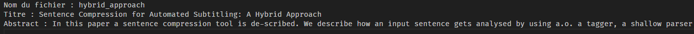
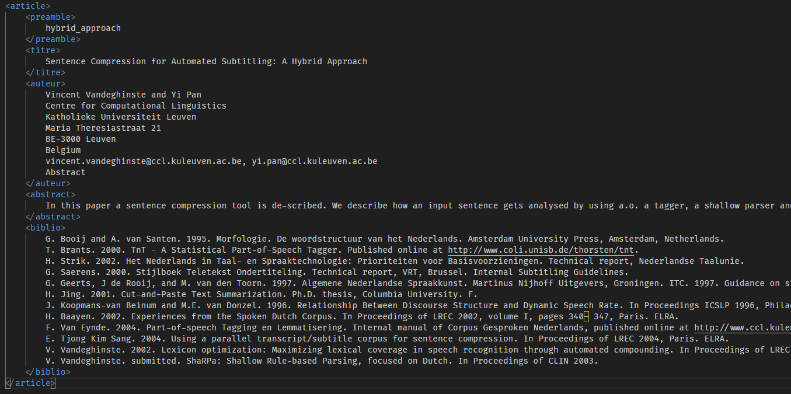
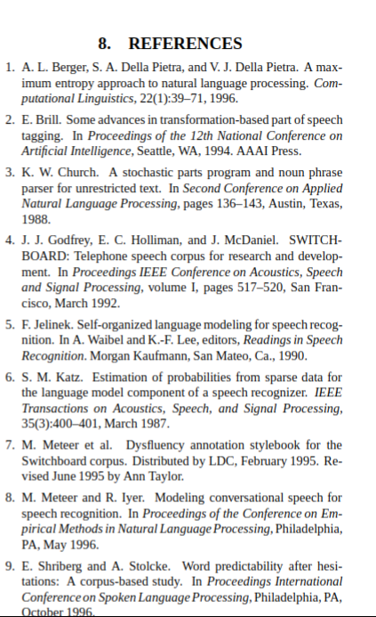
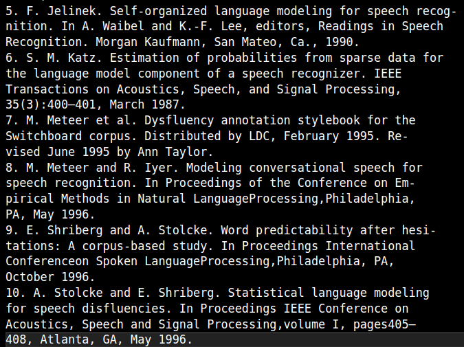
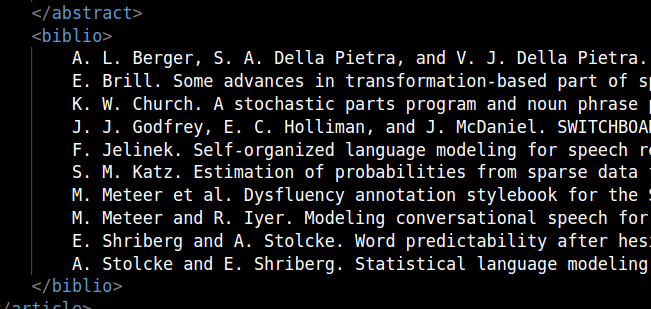
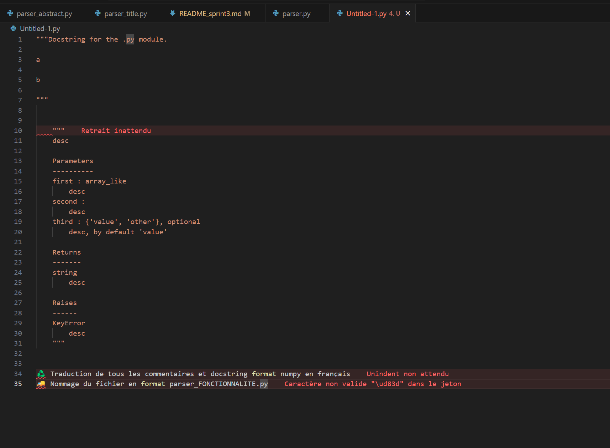
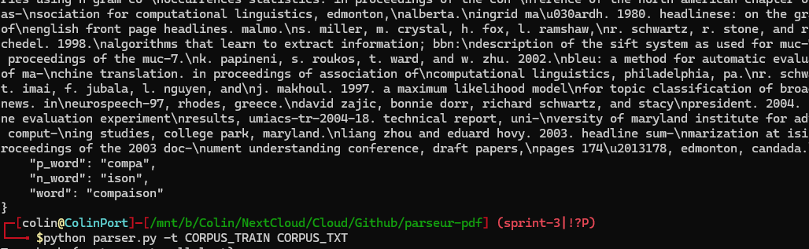
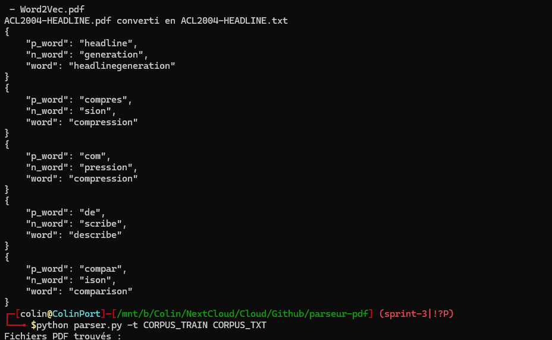
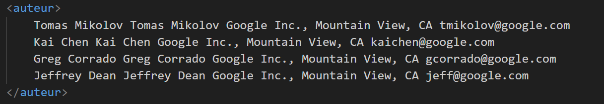

# Sprint 3

**Auteurs : L3 CMI Informatique**

- Angelo Adragna
- Corentin Saccoman
- Elliot Pozucek
- Colin Palazzetti Rubera
- Elvin Fichot-Corgeron

**lien vers Github**
[README Sprint 3](https://github.com/conception-logicielle-CERI/parseur-pdf/blob/sprint-3/README_sprint3.md)

<!--pandoc README_sprint1.md -o README_sprint1.pdf --pdf-engine=xelatex-->

## **Rôles**
- Angelo est `SCRUM Master` et `Product Owner`, il doit rédiger le rapport avec les différents artefacts.
- Corentin, Elliot, Colin et Elvin sont développeurs.
- Corentin doit s’occuper de l’intégration du fonctionnement XML, depuis l’option de lancement jusqu’à l’écriture des balises.
- Elliot doit récupérer la section bibliographique et renvoyer un texte brut.
- Colin doit harmoniser les différents fichiers.
- Elvin doit récupérer la section de l’auteur et renvoyer un texte brut.

## **Objectif**
Suite à une discussion au LIA, nous avons décidé que les fichiers parsés plein texte ne suffisent plus à
nos besoins. Nous avons entendu parler que les fichiers structurés XML possèdent plusieurs avantages
et qu’ils sont largement utilisés en TAL. Nous préférons donc comme sortie un fichier XML utf8 avec
la structure suivante:
```xml
<article>
 <preamble> Le nom du fichier d’origine </preamble>
 <titre> Le titre du papier </titre>
 <auteur> La section auteurs et leur adresse </auteur>
 <abstract> Le résumé de l’article </abstract>
 <biblio> Les références bibliographiques du papier</biblio>
</article>
```
Cependant quelques chercheurs veulent garder la sortie texte aussi… Cette nouvelle sortie .xml
complète la sortie texte .txt du sprint précédent.
Ainsi, au moment de lancer votre parseur, il faudra ajouter un argument ( -t | -x ) pour bien choisir le
type de sortie : soit générer des fichiers dans une version texte (-t) , soit au format XML (-x)
Les détailles sont dans le [sprint3](sprint3_carnet_du_produit.pdf).

## **Execution du programme**
    Format txt sans option  : python parser.py CORPUS_TRAIN/ CORPUS_TXT/
    Format txt avec option  : python parser.py -t CORPUS_TRAIN/ CORPUS_TXT/
    Format xml              : python parser.py -x CORPUS_TRAIN/ CORPUS_XML/

    Résultats attendus:  
    Le répértoire CORPUS_TXT/ contiendra les fichiers texte avec uniquement le nom du fichier, le titre et l'abstract  
    Le répértoire CORPUS_XML/ contiendra les fichiers texte avec toutes les infos demandées pour le xml  

## **Revu Sprint 2**
- Debrief sur le produit du second sprint positif. Le travail a été complexe mais correctement effectué par chaque membre de la `SCRUM Team`.
- Liste de questions à donner au Scrum Master pour qu'il échange avec le client sur les besoins.
- Répartition des tâches selon les affinités de chacun. Bonne communication et cohésion d'équipe.
- Questionnement, refactor et harmonisation des fichiers pour une meilleure lisibilité et compréhension.
- Les artefacts ne semblent plus poser de problèmes, bien qu'un léger doute plane encore. Cependant, la méthode SCRUM est volontairement peu détaillée, donc cela semble naturel.
- Les différents rendus des devs étaient trop proches du rendu du produit du sprint 2.
- Très bonne cohésion d'équipe. Elliot a réalisé un acte d'entraide remarquable. En effet, Corentin a eu un imprévu, ce qui fait qu'il aurait été en retard sur la réalisation de son compte rendu. C'est donc Elliot qui s'est volontairement proposé pour réaliser le susdit compte rendu.


## **Réunion planification Sprint 05/05/25**
  
Retranscription :
- Échange avec le client pour connaître son besoin par rapport à l'extraction des auteurs. Le client souhaite-t-il avoir une balise auteur par auteur ? La réponse est oui.
- S'assurer que le parsage est réalisé sur tout le document PDF et pas uniquement la première page. Sinon, le système devra être modifié afin de récupérer le champ bibliographique, souvent à la fin du PDF.
- Améliorer les différentes fonctions, notamment le parsage d'abstract.
- Réalisation du backlog en priorité, puis des autres artefacts.
- Détermination de la docstring par Colin et Angelo.
- Discussion de l'équipe afin de confirmer le choix de continuer en Python.


## **Backlog**
- Option XML au lancement (texte brut par défaut) et traduction texte XML.
- Récupérer la section auteur.
- Récupérer la section bibliographique.
- Harmoniser les fichiers de code.
- Améliorer les fonctionnalités du code.
- Réaliser les artefacts compris dans le conteneur de ce sprint 3.

## **Burndown**
  


## _Consignes pour le compte rendu des développeurs_ : 
- Déposez votre compte rendu au plus tard le 09/05/2025 à 18h sur la branche 3.
- Fournir AU MOINS une image de l’avancement par fonctionnalité par développeur.
- Votre compte rendu doit comporter une analyse de votre développement, les aspects positifs, négatifs, limitations…
- Indiquer quel jour vous avez fini chaque fonctionnalité.

## **Travail de chaque menebre de la `SCRUM Team` pendant la mêlée (Revue Sprint)**

---

## 1. **Angelo Adragna** : Documentation des événements/artefacts Scrum (réunions de planification de sprint, mêlée quotidienne, revue de sprint, rétrospective du sprint).
- Les backlogs doivent être réalisés en premier lieu, lors de la première réunion, afin de répartir les tâches entre chaque personne.
- La réunion a permis d'établir la liste de questions pour le client, afin d'obtenir davantage de détails et de spécifications.
- Le Burndown est facile à réaliser à la toute fin du sprint.
- La rédaction doit cependant se faire au fur et à mesure de l'avancement de chacun.
- La mise en commun du travail de chacun peut parfois s'avérer ardue, en raison du manque de détails dans le fonctionnement des productions personnelles des développeurs.
- J'ai pris en compte la deadline trop proche de la fin du sprint, afin d'éviter un rush final.
- Médiation et conseils aux développeurs.


---

## 2. **Corentin Saccoman** :  L'intégration du fonctionnement XML depuis l'option de lancement jusqu'à l'écriture des balises XML.
   
### Analyse du code
L'intégration du mode XML repose sur la fonction parse_arguments, écrite pour gérer les arguments passés en ligne de commande. Deux options sont proposées :

- **-t** (par défaut) pour une sortie en plain text
- **-x** pour une sortie au format XML

Ces deux options sont exclusives l'une de l'autre (on ne peut pas les cumuler).

Cette fonction se charge également de récupérer les chemins du répertoire d'entrée et du répertoire de sortie.

Les arguments ainsi extraits sont ensuite utilisés dans les différentes fonctions de traitement (dont les noms ont été modifiés pour s'adapter à la nouvelle demande):

```python
def pdfs_to_format(repertoire_entree: Path, repertoire_sortie: str, args)

def convert_pdf_file(fichier_pdf: Path, repertoire_sortie: Path, args)

def add_infos_to_file(fichier: Path, args)
```

### Exemples d'utilisation:
    Format txt sans option  : python parser.py CORPUS_TRAIN/ CORPUS_TXT/
    Format txt avec option  : python parser.py -t CORPUS_TRAIN/ CORPUS_TXT/
    Format xml              : python parser.py -x CORPUS_TRAIN/ CORPUS_XML/

    Résultats attendus:  
    Le répértoire CORPUS_TXT/ contiendra les fichiers texte avec uniquement le nom du fichier, le titre et l'abstract  
    Le répértoire CORPUS_XML/ contiendra les fichiers texte avec toutes les infos demandées pour le xml  

### Comparaison des formats
**FORMAT TXT**  
  
**FORMAT XML**  
  

Chaque fonction adapte son comportement en fonction du mode choisi, que ce soit pour le traitement du contenu ou la génération de fichiers avec la bonne extension (.txt ou .xml) et la bonne structure de données.
### Pistes d'amélioration
- Ajout d'un mode de test pour pouvoir visualiser la sortie de pdftotext avant nos modifications (Réalisé par Elliot)

- Tests unitaires pour parse_arguments afin d'assurer une robustesse en cas d'ajout d'options futures.

### Analyse de performances

Le mode XML n’introduit pas de surcharge notable dans le traitement des fichiers.  
La principale différence réside dans la structure de sortie, légèrement plus coûteuse en termes de taille mais négligeable sur des volumes faibles à moyens.  
L'appel conditionnel aux traitements en fonction du mode sélectionné évite des branches inutiles dans le pipeline de traitement.

### **Remarque** 
La demande du client est bien respectée avec l'ajout de différentes balises (caractéristiques) qui n'étaient pas présentes dans le format txt.  
Justement, ces parties n'ont pas été ajoutée au format txt, pour la simple et bonne raison que le client ne nous l'a pas demandé. De plus, dans le format txt, il est demandé que chaque partie soit sur une seule ligne à chaque fois, impossible avec les auteurs et les références bibliographiques.

### Dates clés :
- 05/05/2025 : Fin de ma partie et intégration du travail de Colin et d'Elliot. En attente du travail d'Elvin qu'il pourra intégrer lui même (En attente d'ajout d'images).
- 09/05/2025 : Ajout de captures d'écran au readme suite à l'intégration de la partie d'Elvin
   
 ---

## 3. **Elliot Pozucek** : Récupération de la section bibliographique et renvoi dans un fichier texte brut.

### Analyse du code

#### Général

Ajout du fichier `ref_bibblio.py` qui permet de récupérer la section des références bibliographiques d'un corpus textuel (`txt`).

Modification du script `clear_txt.sh` pour ajouter la suppression des xml générés.

Ajout d'un paramètre `-r` pour le script `parser.py` qui permet de parser les fichiers `pdf` dans leur version `txt` sans les transformer. Ils contiennent donc le résultat brut de la commande `pdftotext -raw`. J'ai ajouté ce paramètre afin de pouvoir effectuer des tests.

#### Fonction `get_references`

Cette fonction permet de récupérer la section des références bibliographiques d'un texte. Voici les étapes de la fonction :

- récupérer la section des références bibliographiques d'un texte (cherche la dernière occurence des mots-clés "References" ou "Bibliography", en ignorant la casse)
- nettoyer le texte brute de la section récupérée (enlève les espaces superflus, les sauts de ligne, etc.)
- chercher un pattern de référence bibliographique : dans les trois cas, on cherche une occurence du pattern, puis on récupère le texte compris entre chaque occurence du pattern
    - numérotation '[n]'
    - numérotation 'n.'
    - pas de numérotation -> cherche une initiale (ex: J. Smith), puis saute 30 caractères et cherche à nouveau une initiale
- renvoyer la liste des références bibliographiques trouvées

#### Exemple

Dans le pdf, on a :



Après avoir parsé le pdf, on a :



Puis dans le xml, on a :



#### Explication pour le pattern sans numérotation

Le pattern sans numérotation est le plus complexe à mettre en place. En effet, je n'ai pas trouvé de solution robuste à tous les cas de figure. J'ai donc décidé de faire un compromis entre la robustesse et la simplicité.

J'ai d'abord remarqué que seul deux textes de `CORPUS_TRAIN` contiennent des références bibliographiques sans numérotation. J'ai ensuite remarqué que dans ces deux textes, les références commencent toutes par une initiale en majuscules puis d'un point (ex: J. Smith).  
Cependant, la plupart des références contiennent plusieurs initiales (ex: J. Smith et A. Doe). J'ai donc décidé de chercher une initiale en majuscule suivie d'un point, puis de sauter 30 caractères (toujours moins que la longueur d'une référence) et de chercher à nouveau une initiale en majuscule.

Pour notre corpus, cette méthode fonctionne très bien. J'ai intégré mon travail dans le fichier `parser.py`. Mon travail est utilisé pour générer les fichiers xml.


#### Ajout d'un paramètre `-r` pour le script `parser.py`

Ce paramètre permet de parser les fichiers `pdf` dans leur version `txt` sans les transformer. Ils contiennent donc le résultat brut de la commande `pdftotext -raw`. J'ai ajouté ce paramètre afin de pouvoir effectuer des tests.

### Pistes d'amélioration

Les méthodes de recherche de pattern sont très simples et sont adaptées à notre corpus. Elles manquent donc de robustesse.

Je commence à voir les limitations de notre méthode de base pour extraire le texte brut. En effet, ne pas pouvoir utiliser les retours/sauts de ligne pour séparer les différentes sections du texte est très contraignant, car ces sauts/retours de ligne ont souvent une valeur sémantique significative.

**IMPORTANT** : le fichier ACL2004 pose problème (pas d'intiale et pas de numérotation). Il faut donc le traiter à part.


### Analyse de performances

En terme de performance, la méthode que j'ai mise en place dans le sprint 2 (`log_execution_time`) nous est très utile. En effet, la moyenne des temps d'exécution de l'ensemble de notre programme est passé de 0.5 secondes à 1.25 secondes sur ma machine. 

On peut donc dire que la méthode de recherche de pattern est très gourmande en temps d'exécution.


---

## 4. **Colin Palazzetti Rubera** : Harmonisation des différents fichiers de code, notamment avec les docstrings au format Numpydoc.

### Analyse du code
- La docstring est globalement déjà complète, mais rédigée dans différents formats selon les développeurs.
- Mes modifications étant transparentes, j’ai pu les faire sans problème.
- La seule partie « visible » pour les développeurs a été l’harmonisation des noms de fichiers.

### Pistes d’amélioration
- Optimisations possibles des regex.
- Le code est assez complexe, et je pense qu’une factorisation serait possible.
- Une réflexion autour du cache pour l’étape intermédiaire serait intéressante.
- Ce code fonctionne uniquement sous Linux (avec `pdftotext` installé) :
    - Aucune gestion de l’absence du programme.
    - `FileNotFoundError: [WinError 2] Le fichier spécifié est introuvable` sous Windows 11 (hors cadre, mais testé).

### Analyse des performances
Ayant relu l’ensemble du projet, j’ai pu détecter des pistes particulières d’amélioration :
- Ouvertures multiples du fichier `.txt` détectées — cette partie a été réduite au minimum.
- Beaucoup de regex, parfois combinables — non optimisé.

Le fichier (non commit) local utilisé pour garder de la cohérence dans les docstrings :  



### Amélioration Sprint 2

#### Récupération de l’abstract
Sachant qu’on a maintenant le `.txt` de tout l’article, il est possible de rechercher des mots dans l’article pour essayer de trouver ceux qui existent déjà.

Ajout dans le code :
```diff
- if False:
+ if word.lower() in txt_lower:
```
J'ai du corriger un petit bug : en retirant le `-` pour préparer la recherche de mot dans le sprint 2, je retirait une lettre en plus `compre-{\n}ssion` ⇒ `comprssion`, ce sui rendait la recherche impossible.

Détection du bug à l'aide de la fonction `json.dumps` :



Cette partie s'ajoute aussi au txt.
---

## 5. **Elvin Fichot-Corgeron** : Récupération de la section de l’auteur et renvoi dans un fichier texte brut.

### Approche du travail

Pour réaliser cette tâche, plusieurs solutions étaient possibles :

- Renvoyer la section entière des auteurs dans une seule chaîne.
- Renvoyer un tableau de chaînes de caractères contenant le nom des auteurs et, si elles sont présentes, les adresses associées.

Après concertation, cette deuxième solution s’est avérée être la meilleure.

### Développement

Le travail a été réalisé dans le fichier `parser_auteur`.

J’ai divisé cette étape en trois méthodes distinctes :

#### `get_list`

Dans cette méthode, je m’occupe d’extraire la section contenant les auteurs.

Cette section se trouve toujours entre la section du titre et l’abstract.

Je me suis donc servi des méthodes `parser_title.get_string` et `parser_abstract.get_string` pour les récupérer.

Ensuite, je récupère la section située entre les deux.

#### `mapAuteurs`

C’est dans cette méthode que je décortique la chaîne passée en paramètre pour obtenir l’association entre les auteurs et leurs adresses.

Le plus difficile dans ce travail a été qu’il existe beaucoup de cas potentiels à traiter :

- Un `*` à la fin du titre avec la référence qui ne se trouve pas dans la section des auteurs.
- Les adresses mail notées sous cette forme : `{a,b}@domaine`.
- Des numéros pour les auteurs.
- Des noms seuls.
- Une notation de type nom, adresse de l’université, adresse mail.

Il a donc été très difficile d’avoir un résultat optimisé compte tenu de toutes ces possibilités.

#### `get_string`

Cette méthode joue un peu le rôle de **main** du fichier.

J’y fais l’extraction de la section des auteurs, je l’envoie dans le mapper, puis je retourne le tableau contenant les auteurs.

Pour le résultat en XML, on obtient ceci :  


Pour ce PDF :  


### Difficultés rencontrées

Comme dit plus haut, le plus difficile a été de traiter les nombreux cas différents. Chaque fois que je résolvais un cas, il y en avait fréquemment un autre qui posait problème.  
J’ai donc une version qui n’est pas la plus optimisée, mais qui renvoie les informations essentielles.

Au moment de merger mon code, je ne l’avais pas correctement adapté à la nouvelle norme de code mise en place, ce qui a causé des erreurs.

De plus, pour certains fichiers, j’avais fait les tests uniquement sur le début des fichiers, comme au sprint précédent. Or, pour récupérer la bibliographie, nous utilisons maintenant le fichier en entier.  
J’ai donc limité la recherche à 50 lignes pour localiser la section des auteurs.

### Rétrospective

Mes axes d’amélioration pourraient être :
- Avoir un code plus optimisé, capable de donner des informations encore plus précises.
- Mieux me coordonner avec l’équipe pour éviter les problèmes liés aux nouvelles normes mises en place.


---
A faire à la fin
## **Retour sur le travail effectué (Rétrospective Sprint 3)**

  
### **Ce que nous avons déterminé**

### **Ce qui a bien fonctionné**

### **Ce qui a posé problème**
PATCH
Au niveau du développement, le principal problème a été d'identifier le début et la fin des différentes zones de titre et d'abstract, sachant que ces zones ne sont pas toujours déclarées de façon précise. Notamment pour le fichier `mikheev.pdf`, où le titre récupère uniquement la lettre 'c'.  
Au niveau organisationnel, la deadline imposée par le Scrum Master pour la finition du code et du compte rendu par les développeurs était trop proche de la date de rendu au client.  
Cela a poussé toute l'équipe à effectuer un rush final.

### **Ce qu’on doit améliorer**
Les comptes rendus de certains développeurs ne répondent pas entièrement aux attentes détaillées dans les consignes.

---

### **Conclusion** :
Le travail global effectué par l'équipe est satisfaisant.  
Le travail des personnes impliquées est efficace et très satisfaisant.  
La communication est bonne, et l'on distingue une réelle amélioration dans le travail de chacun, tant au niveau de la qualité que de la quantité.

