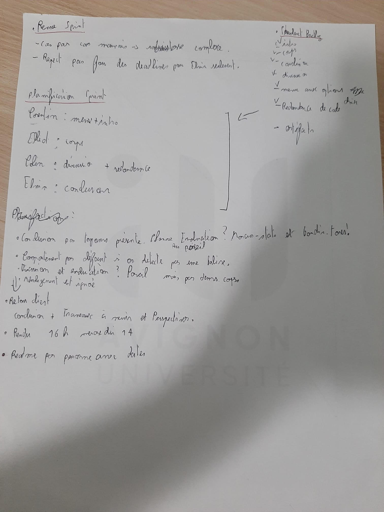
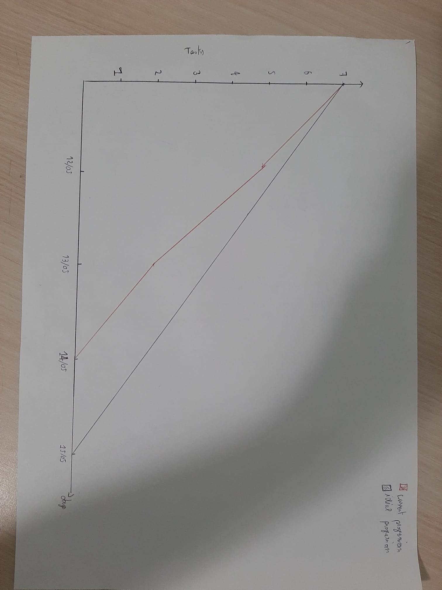

# Sprint 4

**Auteurs : L3 CMI Informatique**

- Angelo Adragna
- Corentin Saccoman
- Elliot Pozucek
- Colin Palazzetti Rubera
- Elvin Fichot-Corgeron

**lien vers Github**
[README Sprint 4](https://github.com/conception-logicielle-CERI/parseur-pdf/edit/sprint-4/README_sprint4.md)

<!--pandoc README_sprint1.md -o README_sprint1.pdf --pdf-engine=xelatex-->

## **Rôles**

- Angelo est `SCRUM Master` et `Product Owner`, il doit rédiger le rapport avec les différents artefacts.
- Corentin, Elliot, Colin et Elvin sont développeurs.
- Les développeurs s’occupent de l’enrichissement du xml avec de nouvelles balises : introduction ,corps, conclusion, discussion ainsi que l'ajoue d'un menu au lancement.
- Corentin doit récupérer la section `intro` et réaliser le menu de lancement.
- Elliot doit récupérer la section `corps`.
- Colin doit récupérer la section `discussion` (`evaluation`) et s'occupe de la redondance de certains codes.
- Elvin doit récupérer la section `conclusion` comprenant également  par exemple  `Travaux à venir` ou `Perspectives`.

## **Objectif**

Suite à d’autres études de marché, nous avons conclu que la structure XML doit être enrichie avec les
sections suivantes:
```xml
<article>
 <preamble> Le nom du fichier d’origine </preamble>
 <titre> Le titre du papier </titre>
 <auteur> La section auteurs et leur adresse</auteur>
 <abstract> Le résumé de l’article</abstract>
 <introduction> La introduction</introduction>
 <corps> Le développement du papier</corps>
 <conclusion> La conclusion du papier</conclusion>
 <discussion> La discussion du papier</discussion>
 <biblio> Les références bibliographiques du papier</biblio>
</article>
```

Également, une nouvelle exigence du département de production, demande d'ajouter un menu au début
de l’exécution du système afin de choisir certains PDFs à parser (pas le répertoire complet).  
Rendu : Avant sprint final  
Le système final, et les versions intermédiaires doivent être placés sur Github ; chaque version dans
une branche différente. Le fichier README.md doit contenir une explication générale du système et la
procédure nécessaire pour lancer les programmes.  
Ainsi il faut documenter tout les différents événements de la méthode Scrum en ajoutant sur l’ENT des photos de votre travail
(réunions de planification de sprint, mêlée quotidienne, revue de sprint, rétrospective du sprint). 
Les détailles sont dans le [sprint3](sprint3_carnet_du_produit.pdf). 

## **Execution du programme** >A faire

    Format txt sans option  : python parser.py CORPUS_TRAIN/ CORPUS_TXT/
    Format txt avec option  : python parser.py -t CORPUS_TRAIN/ CORPUS_TXT/
    Format xml              : python parser.py -x CORPUS_TRAIN/ CORPUS_XML/

    Résultats attendus:

Le répértoire CORPUS_TXT/ contient les fichiers texte avec uniquement le nom du fichier, titre et abstract.
Le répértoire CORPUS_XML/ contiendra les fichiers texte avec toutes les infos demandées pour le xml.

## **Revu Sprint 4**

- Debrief sur le produit du troisième sprint mitigé. Le travail a été complexe mais effectué par chaque membre de la `SCRUM Team`.
- Liste de questions à donner au Scrum Master pour qu'il échange avec le client sur les besoins.
- Répartition des tâches selon les affinités de chacun. Bonne communication.
- Le code à correctement été refactor, ce qui permet aux développeurs de partir sur une base harmonisée.
- Les différents rendus des devs étaient très satisfaisant hormis pour Elvin qui à rendu un travail moyennement satisfaisant et en retard.
- Un problème commun aux développeurs semble être le manque de robustesses du aux différements formats possibles au seins des PDF.
  
## **Réunion planification Sprint 13/05/25** A faire images

  
Retranscription :

- Échange avec le client pour connaître ses besoins par rapport à l'extraction des auteurs :
   - Le client souhaite-t-il que `discussion` et `evaluation` soient fusionnées ? La réponse est oui.
   - Que souhaite le client si une section est manquante dans le PDF originel ? La balise xml sera vide.
   - Que souhaite le client par rapport à une potentielle section de `remerciements` ? On l'ignore.
- Réalisation du backlog en priorité, puis des autres artefacts.

## **Backlog**

- Menu menu au début de l’exécution du système afin de choisir certains PDFs à parser au lancement.  
- Récupérer la section introduction.
- Récupérer la section corps.
- Récupérer la section discussion. 
- Récupérer la section conclusion. 
- Supprimer certaines redondances dans les fichiers de code.
- Améliorer les fonctionnalités du code.
- Réaliser les artefacts compris dans le conteneur de ce sprint 4.

## **Burndown**  A faire images



## _Consignes pour le compte rendu des développeurs_ :

- Déposez votre compte rendu au plus tard le mercredi 14/05/2025 à 16h sur la branche 4.
- Fournir AU MOINS une image de l’avancement par fonctionnalité par développeur.
- Votre compte rendu doit comporter une analyse de votre développement, les aspects positifs, négatifs, limitations… Vous pourrez vous baser sur le squelette pour vous guider si nécéssaire.
- Indiquer quel jour vous avez fini chaque fonctionnalité !

## **Travail de chaque menebre de la `SCRUM Team` pendant la mêlée (Revue Sprint)**

---

## 1. **Angelo Adragna** : Documentation des événements/artefacts Scrum (réunions de planification de sprint, mêlée quotidienne, revue de sprint, rétrospective du sprint).

- Les backlogs doivent être réalisés en premier lieu, lors de la première réunion, afin de répartir les tâches entre chaque personne.
- La réunion a permis d'établir la liste de questions pour le client, afin d'obtenir davantage de détails et de spécifications.
- Le Burndown se termine à la fin du sprint 4.
- La rédaction se fait au fil du sprint.
- Création d'un squelette de rendu pour facilier la mise en commun du travail de chacun. Je propose donc un modèle en raison du manque de détails dans les productions personnelles des développeurs.
- Médiation et conseils aux développeurs.

---

## 2. **Corentin Saccoman** : Récupération de la section `intro` et réaliser le menu de lancement.
### Analyse du code


### Pistes d'amélioration


### Analyse de performances


### **Remarque**


### Dates clés :

 
  ---

## 3. **Elliot Pozucek** : Récupération de la section `corps`.

### Analyse du code


### Pistes d'amélioration


### Analyse de performances


### **Remarque**


### Dates clés :

 
  ---

## 4. **Colin Palazzetti Rubera** : Récupération de la section `discussion` (`evaluation`) et s'occupe de la redondance de certains codes.

### Analyse du code


### Pistes d'amélioration


### Analyse de performances


### **Remarque**


### Dates clés :

 
  ---

## 5. **Elvin Fichot-Corgeron** : Récupération de la section `conclusion` comprenant également  par exemple  `Travaux à venir` ou `Perspectives`.

### Analyse du code


### Pistes d'amélioration


### Analyse de performances


### **Remarque**


### Dates clés :

 
  ---

## **Retour sur le travail effectué (Rétrospective Sprint 4)**

### **Ce que nous avons déterminé**

- Les backlogs doivent être réalisés en premier lieu, lors de la première réunion, afin de répartir les tâches entre chaque personne.

- La réunion a permis d'établir la liste de questions pour le client, afin d'obtenir davantage de détails et de spécifications.

- Le Burndown est facile à réaliser à la toute fin du sprint.

-La rédaction doit cependant se faire au fur et à mesure de l'avancement de chacun.

-La mise en commun du travail de chacun peut parfois s'avérer ardue, en raison du manque de détails dans le fonctionnement des productions personnelles des développeurs.

-Il faut prendre en compte la deadline trop proche de la fin du sprint, afin d'éviter un rush final.

-Médiation et conseils apportés aux développeurs.

### **Ce qui a bien fonctionné**

- Bonne répartition des tâches entre les membres, chacun a pu avancer sur sa partie sans trop d'interférences.

- L’intégration progressive des travaux (Colin, Elliot, Corentin) a permis une mise en commun fluide.

- Les réunions Scrum ont été efficaces pour identifier les points bloquants et ajuster les priorités.

- La génération des fichiers XML et TXT selon les besoins du client a été bien maîtrisée.

- L’outil de mesure des performances a aidé à identifier les parties gourmandes du code.

- Les comptes rendus sont de meilleure qualité.
-

### **Ce qui a posé problème**

- Le fichier ACL2004 pose toujours problème car il ne suit aucun des patterns définis.

- Les méthodes de recherche de pattern pour les références bibliographiques restent trop simples et spécifiques à notre corpus.

- Certaines optimisations de regex et de factorisation n’ont pas pu être intégrées à temps.

- L’absence de gestion multiplateforme (ex. : Windows) n’a pas été traitée, alors qu’elle pourrait causer des erreurs.

- La rédaction des documentations (docstrings, README) est parfois restée en retrait face à l’avancée du code.

### **Ce qu’on doit améliorer**

- Mettre en place des tests unitaires, notamment pour parse_arguments afin de préparer l’ajout d’options futures.

- Rendre le code plus robuste en prévoyant les cas particuliers comme ACL2004, avec une gestion dédiée.

- Améliorer la robustesse des méthodes de détection des sections (abstract, références) dans les textes.

- Factoriser certaines parties du code et optimiser les regex pour réduire les coûts de performance.

- Penser à une compatibilité multiplateforme (Windows/Linux) et prévoir la gestion d’erreurs liées à l’environnement.

---

## **Conclusion** :

### Selon Angelo Adragna

- La méthodologie Scrum (planification, mêlée quotidienne, revue, rétrospective) a structuré efficacement le travail.
- Rôle clé en médiation, coordination des deadlines et rédaction progressive des artefacts.
- Préparation des backlogs dès la première réunion et liste précise de questions pour cadrer les objectifs.
- Mise en commun parfois difficile à cause d’un manque de détails sur les productions personnelles.
- La prise en compte d’une deadline avancée a permis d’éviter un rush final.

### Selon Corentin Saccoman

- Intégration du mode XML, structuration des fonctions pour gérer `-t` et `-x`.
- Respect des attentes client en limitant certaines informations au mode XML.
- Proposition d’ajouter des tests unitaires sur les arguments pour anticiper les évolutions.
- Performances satisfaisantes, mais vigilance sur l’impact de la structure XML sur la taille des fichiers.

### Selon Elliot Pozucek

- Développement de la récupération automatisée des références bibliographiques (méthodes adaptées au corpus mais encore peu robustes).
- Ajout du mode `-r` pour les tests internes ; certaines méthodes sont gourmandes en temps d’exécution.
- Limites identifiées liées à l’absence de structure sémantique (retours à la ligne) ; proposition d’y réfléchir pour les prochains sprints.
- Cas particuliers (ex. ACL2004) nécessitant un traitement spécifique.

### Selon Colin Palazzetti Rubera

- Harmonisation des docstrings au format Numpydoc pour améliorer la lisibilité et la documentation.
- Détection d’améliorations potentielles : optimisation des regex, factorisation du code.
- Problème de compatibilité (dépendance à `pdftotext` sous Linux), proposition de renforcer la portabilité.
- Correction d’un petit bug dans la recherche d’abstracts.

### Global

Le travail global effectué par l'équipe est satisfaisant.  
Le travail des personnes impliquées est efficace et très satisfaisant.  
La communication est bonne, et l'on distingue une réelle amélioration qualitative dans le travail de chacun.
