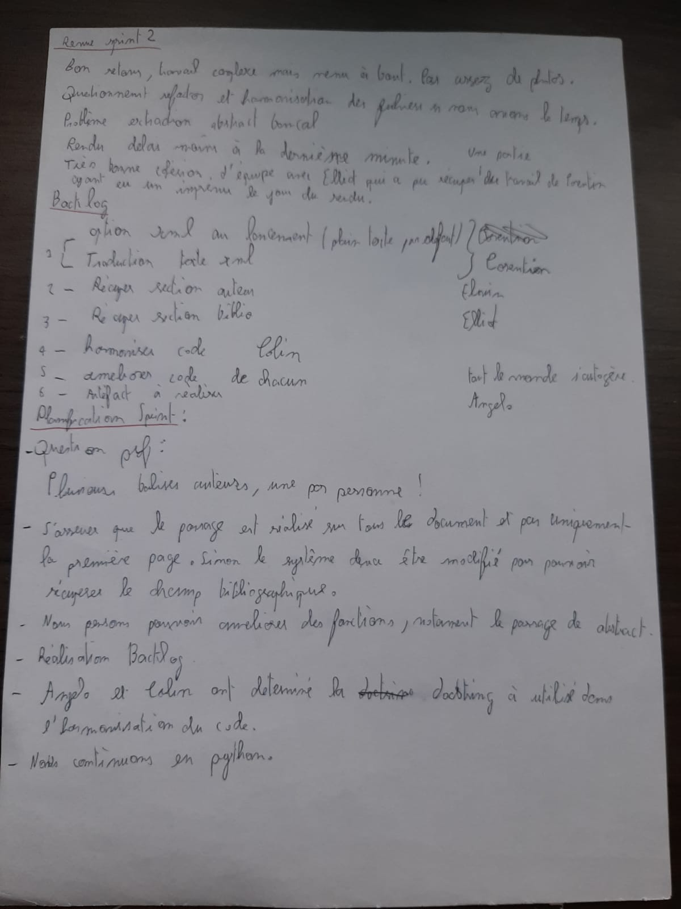

# Sprint 4

**Auteurs : L3 CMI Informatique**

- Angelo Adragna
- Corentin Saccoman
- Elliot Pozucek
- Colin Palazzetti Rubera
- Elvin Fichot-Corgeron

**lien vers Github**
[README Sprint 4](https://github.com/conception-logicielle-CERI/parseur-pdf/edit/sprint-4/README_sprint4.md)

<!--pandoc README_sprint1.md -o README_sprint1.pdf --pdf-engine=xelatex-->

## **Rôles**

- Angelo est `SCRUM Master` et `Product Owner`, il doit rédiger le rapport avec les différents artefacts.
- Corentin, Elliot, Colin et Elvin sont développeurs.
- Les développeurs s’occupent de l’enrichissement du xml avec de nouvelles balises : introduction ,corps, conclusion, discussion.
- Corentin doit s’occuper de l’enrichissement du xml avec de nouvelles balises : introduction ,corps, conclusion, discussion.
- Elliot doit récupérer la section corps.
- Colin doit récupérer la section discussion et s'occupe de la redondance de certains codes.
- Elvin doit récupérer la section de l’auteur et renvoyer un texte brut.

## **Objectif**

Suite à une discussion au LIA, nous avons décidé que les fichiers parsés plein texte ne suffisent plus à
nos besoins. Nous avons entendu parler que les fichiers structurés XML possèdent plusieurs avantages
et qu’ils sont largement utilisés en TAL. Nous préférons donc comme sortie un fichier XML utf8 avec
la structure suivante:

```xml
<article>
 <preamble> Le nom du fichier d’origine </preamble>
 <titre> Le titre du papier </titre>
 <auteur> La section auteurs et leur adresse </auteur>
 <abstract> Le résumé de l’article </abstract>
 <biblio> Les références bibliographiques du papier</biblio>
</article>
```

Cependant quelques chercheurs veulent garder la sortie texte aussi… Cette nouvelle sortie .xml
complète la sortie texte .txt du sprint précédent.
Ainsi, au moment de lancer votre parseur, il faudra ajouter un argument ( -t | -x ) pour bien choisir le
type de sortie : soit générer des fichiers dans une version texte (-t) , soit au format XML (-x)
Les détailles sont dans le [sprint3](sprint3_carnet_du_produit.pdf).

## **Execution du programme**

    Format txt sans option  : python parser.py CORPUS_TRAIN/ CORPUS_TXT/
    Format txt avec option  : python parser.py -t CORPUS_TRAIN/ CORPUS_TXT/
    Format xml              : python parser.py -x CORPUS_TRAIN/ CORPUS_XML/

    Résultats attendus:

Le répértoire CORPUS_TXT/ contient les fichiers texte avec uniquement le nom du fichier, titre et abstract.
Le répértoire CORPUS_XML/ contiendra les fichiers texte avec toutes les infos demandées pour le xml.

## **Revu Sprint 2**

- Debrief sur le produit du second sprint positif. Le travail a été complexe mais correctement effectué par chaque membre de la `SCRUM Team`.
- Liste de questions à donner au Scrum Master pour qu'il échange avec le client sur les besoins.
- Répartition des tâches selon les affinités de chacun. Bonne communication et cohésion d'équipe.
- Questionnement, refactor et harmonisation des fichiers pour une meilleure lisibilité et compréhension.
- Les artefacts ne semblent plus poser de problèmes, bien qu'un léger doute plane encore. Cependant, la méthode SCRUM est volontairement peu détaillée, donc cela semble naturel.
- Les différents rendus des devs étaient trop proches du rendu du produit du sprint 2.
- Très bonne cohésion d'équipe. Elliot a réalisé un acte d'entraide remarquable. En effet, Corentin a eu un imprévu, ce qui fait qu'il aurait été en retard sur la réalisation de son compte rendu. C'est donc Elliot qui s'est volontairement proposé pour réaliser le susdit compte rendu.

## **Réunion planification Sprint 05/05/25**

  
Retranscription :

- Échange avec le client pour connaître son besoin par rapport à l'extraction des auteurs. Le client souhaite-t-il avoir une balise auteur par auteur ? La réponse est oui.
- S'assurer que le parsage est réalisé sur tout le document PDF et pas uniquement la première page. Sinon, le système devra être modifié afin de récupérer le champ bibliographique, souvent à la fin du PDF.
- Améliorer les différentes fonctions, notamment le parsage d'abstract.
- Réalisation du backlog en priorité, puis des autres artefacts.
- Détermination de la docstring par Colin et Angelo.
- Discussion de l'équipe afin de confirmer le choix de continuer en Python.

## **Backlog**

- Option XML au lancement (texte brut par défaut) et traduction texte XML.
- Récupérer la section auteur.
- Récupérer la section bibliographique.
- Harmoniser les fichiers de code.
- Améliorer les fonctionnalités du code.
- Réaliser les artefacts compris dans le conteneur de ce sprint 3.

## **Burndown**


## _Consignes pour le compte rendu des développeurs_ :

- Déposez votre compte rendu au plus tard le 09/05/2025 à 18h sur la branche 3.
- Fournir AU MOINS une image de l’avancement par fonctionnalité par développeur.
- Votre compte rendu doit comporter une analyse de votre développement, les aspects positifs, négatifs, limitations…
- Indiquer quel jour vous avez fini chaque fonctionnalité.

## **Travail de chaque menebre de la `SCRUM Team` pendant la mêlée (Revue Sprint)**

---

## 1. **Angelo Adragna** : Documentation des événements/artefacts Scrum (réunions de planification de sprint, mêlée quotidienne, revue de sprint, rétrospective du sprint).

- Les backlogs doivent être réalisés en premier lieu, lors de la première réunion, afin de répartir les tâches entre chaque personne.
- La réunion a permis d'établir la liste de questions pour le client, afin d'obtenir davantage de détails et de spécifications.
- Le Burndown est facile à réaliser à la toute fin du sprint.
- La rédaction doit cependant se faire au fur et à mesure de l'avancement de chacun.
- La mise en commun du travail de chacun peut parfois s'avérer ardue, en raison du manque de détails dans le fonctionnement des productions personnelles des développeurs.
- J'ai pris en compte la deadline trop proche de la fin du sprint, afin d'éviter un rush final.
- Médiation et conseils aux développeurs.

---

## 2. **Corentin Saccoman** : L'intégration du fonctionnement XML depuis l'option de lancement jusqu'à l'écriture des balises XML.

### Analyse du code


### Pistes d'amélioration


### Analyse de performances


### **Remarque**


### Dates clés :

 
  ---

## 3. **Elliot Pozucek** : Récupération de la section bibliographique et renvoi dans un fichier texte brut.

### Analyse du code


### Pistes d'amélioration


### Analyse de performances


### **Remarque**


### Dates clés :

 
  ---

## 4. **Colin Palazzetti Rubera** : Harmonisation des différents fichiers de code, notamment avec les docstrings au format Numpydoc.

### Analyse du code


### Pistes d'amélioration


### Analyse de performances


### **Remarque**


### Dates clés :

 
  ---

## 5. **Elvin Fichot-Corgeron** : Récupération de la section de l’auteur et renvoi dans un fichier texte brut.

### Analyse du code


### Pistes d'amélioration


### Analyse de performances


### **Remarque**


### Dates clés :

 
  ---

## **Retour sur le travail effectué (Rétrospective Sprint 3)**

### **Ce que nous avons déterminé**

- Les backlogs doivent être réalisés en premier lieu, lors de la première réunion, afin de répartir les tâches entre chaque personne.

- La réunion a permis d'établir la liste de questions pour le client, afin d'obtenir davantage de détails et de spécifications.

- Le Burndown est facile à réaliser à la toute fin du sprint.

-La rédaction doit cependant se faire au fur et à mesure de l'avancement de chacun.

-La mise en commun du travail de chacun peut parfois s'avérer ardue, en raison du manque de détails dans le fonctionnement des productions personnelles des développeurs.

-Il faut prendre en compte la deadline trop proche de la fin du sprint, afin d'éviter un rush final.

-Médiation et conseils apportés aux développeurs.

### **Ce qui a bien fonctionné**

- Bonne répartition des tâches entre les membres, chacun a pu avancer sur sa partie sans trop d'interférences.

- L’intégration progressive des travaux (Colin, Elliot, Corentin) a permis une mise en commun fluide.

- Les réunions Scrum ont été efficaces pour identifier les points bloquants et ajuster les priorités.

- La génération des fichiers XML et TXT selon les besoins du client a été bien maîtrisée.

- L’outil de mesure des performances a aidé à identifier les parties gourmandes du code.

- Les comptes rendus sont de meilleure qualité.
-

### **Ce qui a posé problème**

- Le fichier ACL2004 pose toujours problème car il ne suit aucun des patterns définis.

- Les méthodes de recherche de pattern pour les références bibliographiques restent trop simples et spécifiques à notre corpus.

- Certaines optimisations de regex et de factorisation n’ont pas pu être intégrées à temps.

- L’absence de gestion multiplateforme (ex. : Windows) n’a pas été traitée, alors qu’elle pourrait causer des erreurs.

- La rédaction des documentations (docstrings, README) est parfois restée en retrait face à l’avancée du code.

### **Ce qu’on doit améliorer**

- Mettre en place des tests unitaires, notamment pour parse_arguments afin de préparer l’ajout d’options futures.

- Rendre le code plus robuste en prévoyant les cas particuliers comme ACL2004, avec une gestion dédiée.

- Améliorer la robustesse des méthodes de détection des sections (abstract, références) dans les textes.

- Factoriser certaines parties du code et optimiser les regex pour réduire les coûts de performance.

- Penser à une compatibilité multiplateforme (Windows/Linux) et prévoir la gestion d’erreurs liées à l’environnement.

---

## **Conclusion** :

### Selon Angelo Adragna

- La méthodologie Scrum (planification, mêlée quotidienne, revue, rétrospective) a structuré efficacement le travail.
- Rôle clé en médiation, coordination des deadlines et rédaction progressive des artefacts.
- Préparation des backlogs dès la première réunion et liste précise de questions pour cadrer les objectifs.
- Mise en commun parfois difficile à cause d’un manque de détails sur les productions personnelles.
- La prise en compte d’une deadline avancée a permis d’éviter un rush final.

### Selon Corentin Saccoman

- Intégration du mode XML, structuration des fonctions pour gérer `-t` et `-x`.
- Respect des attentes client en limitant certaines informations au mode XML.
- Proposition d’ajouter des tests unitaires sur les arguments pour anticiper les évolutions.
- Performances satisfaisantes, mais vigilance sur l’impact de la structure XML sur la taille des fichiers.

### Selon Elliot Pozucek

- Développement de la récupération automatisée des références bibliographiques (méthodes adaptées au corpus mais encore peu robustes).
- Ajout du mode `-r` pour les tests internes ; certaines méthodes sont gourmandes en temps d’exécution.
- Limites identifiées liées à l’absence de structure sémantique (retours à la ligne) ; proposition d’y réfléchir pour les prochains sprints.
- Cas particuliers (ex. ACL2004) nécessitant un traitement spécifique.

### Selon Colin Palazzetti Rubera

- Harmonisation des docstrings au format Numpydoc pour améliorer la lisibilité et la documentation.
- Détection d’améliorations potentielles : optimisation des regex, factorisation du code.
- Problème de compatibilité (dépendance à `pdftotext` sous Linux), proposition de renforcer la portabilité.
- Correction d’un petit bug dans la recherche d’abstracts.

### Global

Le travail global effectué par l'équipe est satisfaisant.  
Le travail des personnes impliquées est efficace et très satisfaisant.  
La communication est bonne, et l'on distingue une réelle amélioration qualitative dans le travail de chacun.
